# Model Studio ⚡

> **Universal AI 2D/3D Model Builder, Rigging & Creative Workspace**  
> *Transform 2D character sheets and multi-view references into production-ready, fully-rigged 3D models and animated avatars.*

[](https://www.typescriptlang.org/)
[](https://react.dev/)
[](https://threejs.org/)
[](https://vitejs.dev/)
[](https://vitest.dev/)
[](https://www.khronos.org/gltf/)
[](https://vrm.dev/)
[](LICENSE)

---

## 🌟 Overview

**Model Studio** is a unified, next-generation creative application designed to bridge concept art and 3D production. Rather than acting as a static dashboard, Model Studio puts the **3D Viewport and Creative Workspace at the center of the experience**:

$$\textbf{MODEL} \longrightarrow \textbf{VIEWPORT} \longrightarrow \textbf{AI} \longrightarrow \textbf{ANIMATION}$$

From multi-view character turnarounds to watertight solid geometries and VRM humanoid avatars, Model Studio orchestrates computer vision, volumetric reconstruction, skinning, and universal format export in real time.

---

## 🚀 Core Features

### 🧊 1. Genuine Volumetric 3D Reconstruction
- **Volumetric Depth Synthesis**: Generates watertight 3D models with true anatomical thickness ($Z \ge 0.28\text{m}$, rounded torso, volumetric limbs, and 360° hair) — **never flat image cards or thin slabs**.
- **Multi-View Consistency Engine**: Inspects Front, Side, Back, and Top reference images, detecting proportion conflicts, scale variance, and missing depth angles before generation.
- **Continuous Topology & Marching Cubes**: Generates smooth manifold polygon surfaces with dual-atlas UV coordinates and PBR material synthesis.

### 🎨 2. Dual-Mode Creative Workspace (3D Studio & 2D Canvas)
- **3D Studio Viewport**:
  - WebGL PBR rendering pipeline with Key, Fill, Rim, and Ambient lighting.
  - Interactive Shading Modes: **Textured PBR**, **MatCap Clay**, **Wireframe Overlay**, **Normal Map**, and **Skeleton / X-Ray**.
  - Camera View Presets: Front (`1`), Right (`3`), Top (`7`), Back (`Ctrl+1`), Left (`Ctrl+3`), Perspective (`5`).
  - Transform Gizmos: Translate, Rotate, Scale.
  - Billboard Reference Overlay: Calibrated reference planes with adjustable opacity (separate from exported geometry).
- **2D Canvas Viewport**:
  - Interactive Landmark Pins: Real-time pin dragging (Head, Chin, Shoulders, Pelvis, Knees, Feet) for cross-view alignment calibration.
  - Vector Silhouette Drawing: Pen and path tools for drafting bounding contours.
  - Segmentation Masks: Toggleable region highlighting (hair, apparel, skin).
  - 1-Click SVG Vector Export.

### 🦴 3. Humanoid Rigging & Zero-Drift Locomotion
- **VRM 1.0 Standard Bones**: Hierarchical humanoid joint system matching the official `VRMC_vrm` specification (`hips`, `spine`, `chest`, `neck`, `head`, `shoulders`, `arms`, `legs`, `feet`).
- **Smooth Vertex Skinning**: Heat-diffusion / geometric distance skin weighting with max-4-bone GPU weight normalization.
- **Zero-Drift Grounding**: Procedural locomotion engine ensures sneaker and foot contact remains firmly at $Y = 0.00\text{m} \pm 10^{-4}\text{m}$ across all animation frames (no vertical drift or jumping).
- **Motion Sequencer**: Timeline controls, speed chips, and action libraries (**T-Pose**, **Idle Breathing**, **Walk Cycle**, **Action Stance**).

### 📦 4. Universal Exporter Registry & Capability Matrix
Model Studio employs an extensible format registry with pre-flight capability checks and validation reports:

| Format | Category | Preserved Features | Typical Use Case |
|---|---|---|---|
| **GLB** | 3D Delivery | Meshes, PBR Materials, Textures, Rig, Animations | WebGL, Three.js, Babylon.js, Game Engines |
| **VRM 1.0** | Avatar | Meshes, PBR, VRM Humanoid Bone Mapping, Meta | VTubing, VRChat, Metaverse, Virtual Avatars |
| **OBJ + MTL**| Static Mesh | Watertight Geometry, UVs, Lambert/Diffuse Materials | Blender, Maya, ZBrush, DCC Sculpting |
| **STL** | 3D Printing | Watertight Solid Boundary Envelope | Slicers (Cura, Prusa), Additive Manufacturing |
| **SVG** | 2D Vector | Vector Silhouette Paths, Landmark Pins | UI Assets, Vector Design, Concept Sheets |
| **PNG** | 2D Raster | High-Res Orthographic Snapshot with Alpha | Asset Thumbnails, Documentation |
| **.modelstudio** | Project Archive | Complete Canonical Schema v1.0.0 Project State | Lossless Project Editing & History |

---

## 🏗️ Architecture

```mermaid
flowchart TD
    subgraph UI ["Studio Frontend (React 18 + Three.js)"]
        TB[TopBar: 3D/2D Mode Switcher]
        LP[Left Panel: Multi-View Reference Outliner]
        VP3D[3D Studio: WebGL Viewport + Shading Presets]
        VP2D[2D Canvas: Landmark Pins & Vector Pen]
        RI[Right Inspector: AI Assistant & Rigging]
        BP[Bottom Panel: Timeline & Motion Sequencer]
    end

    subgraph Core ["Canonical Scene Representation (v1.0.0)"]
        CP[Canonical Project Manifest]
        CMD[Editor Commands & Undo/Redo Transactions]
        EB[Event Bus]
    end

    subgraph Intelligence ["Vision & Consistency Pipeline"]
        MVC[Multi-View Consistency & Conflict Engine]
        SAM[Segmentation & Contour Slicing]
        LND[Landmark Alignment Detector]
    end

    subgraph Reconstruction ["Volumetric Reconstruction"]
        VH[Multi-View Visual Hull & SDF Grid]
        MC[Marching Cubes Polygonizer]
        SM[Laplacian Mesh Smoothing]
        UV[Dual-Atlas UV Unwrapper]
    end

    subgraph Rigging ["Rigging & Animation"]
        SG[VRM 1.0 Humanoid Skeleton Generator]
        AW[Distance Weighting & Skinning Matrix]
        LE[Zero-Drift Locomotion & Grounding Engine]
    end

    subgraph Exporters ["Universal Exporter Registry"]
        EX_GLB[glTF 2.0 / GLB]
        EX_VRM[VRM 1.0 Avatar]
        EX_OBJ[Wavefront OBJ + MTL]
        EX_STL[Watertight Binary STL]
        EX_SVG[2D Vector SVG]
    end

    UI --> Core
    Core --> Intelligence
    Intelligence --> Reconstruction
    Reconstruction --> Rigging
    Rigging --> Exporters
```



---

## 🛠️ Tech Stack

- **Frontend Engine**: React 18, TypeScript, Tailwind CSS, Lucide Icons
- **3D Graphics**: Three.js (r170), WebGL, SkinnedMesh deformation, OrbitControls
- **2D Canvas**: HTML5 Canvas, high-DPI scaling, interactive landmark pins
- **Build System**: Vite 5.4, PostCSS, Autoprefixer
- **Test Framework**: Vitest (62 automated tests, 100% pass rate)

---

## 🚦 Getting Started

### Prerequisites
- [Node.js](https://nodejs.org/) (v18.0 or newer recommended)
- `npm` or `pnpm`

### Installation

```bash
# Clone the repository
git clone https://github.com/DeepxkJadhav/ModelStudio.git

# Navigate into the project directory
cd ModelStudio

# Install dependencies
npm install
```

### Running Locally

```bash
# Start Vite development server
npm run dev
```

Open your browser at `http://localhost:5173` to launch Model Studio.

### Running Test Suite

```bash
# Run Vitest unit & integration regression tests
npm test
```

### Building for Production

```bash
# Typecheck and build minified production bundle
npm run build
```

---

## 📁 Repository Structure

```text
ModelStudio/
├── src/
│   ├── animation/           # Locomotion engine, pose evaluation, grounding
│   ├── core/                # Canonical schema, project adapter, state store
│   │   ├── canonicalSchema.ts
│   │   ├── canonicalProjectAdapter.ts
│   │   ├── studioState.tsx
│   │   └── types.ts
│   ├── intelligence/        # View consistency, species classifier, anatomy
│   │   └── multiViewConsistency.ts
│   ├── io/                  # Exporter registry, GLB, VRM, OBJ, STL, validators
│   │   ├── formatRegistry.ts
│   │   ├── gltfExporter.ts
│   │   ├── vrmExporter.ts
│   │   ├── objExporter.ts
│   │   ├── stlExporter.ts
│   │   └── reimportValidator.ts
│   ├── orchestration/       # AI DAG task scheduler & model adapters
│   │   └── aiOrchestrator.ts
│   ├── reconstruction/      # Volumetric visual hull, Marching Cubes, UVs
│   │   ├── highFidelityModelGenerator.ts
│   │   └── marchingCubes.ts
│   ├── references/          # Camera calibration, silhouette extraction
│   ├── rigging/             # Skeleton generator, auto-weighting, finger rig
│   ├── simulation/          # Anti-clipping, cloth & hair simulation
│   ├── ui/                  # UI components, panels, modals
│   │   ├── StudioLayout.tsx
│   │   ├── TopBar.tsx
│   │   ├── LeftPanel.tsx
│   │   ├── RightInspector.tsx
│   │   ├── BottomPanel.tsx
│   │   ├── ViewportCanvas.tsx
│   │   ├── Viewport2DCanvas.tsx
│   │   └── modals/          # ExportModal, Diagnostics, Understanding
│   └── viewport/            # Three.js controller, shading modes, overlays
└── tests/                   # 62 unit & integration tests
```

---

## 📄 License

This project is licensed under the [MIT License](LICENSE).

---

## 👤 Author Remarks

Engineered by [Deep Jadhav](https://github.com/DeepxkJadhav) — Designed to redefine AI-assisted 3D creation by treating the 3D viewport, volumetric geometry, and rigging as first-class citizens.
